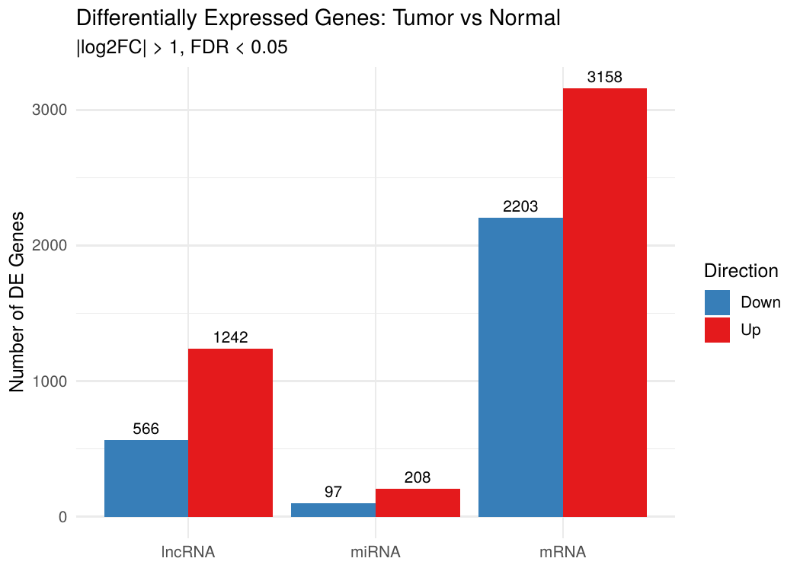
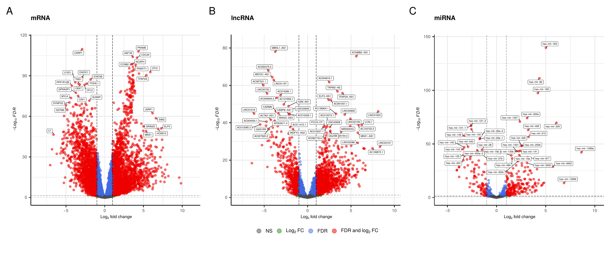

# Competing for miRNAs: ceRNA Networks in Endometrial Cancer

MicroRNAs (miRNAs) silence genes by binding to their messenger RNAs. Some long non-coding RNAs (lncRNAs) carry the same binding sites and act as **sponges**: they soak up miRNAs and so free the genes those miRNAs would otherwise repress. RNAs that regulate each other this way are called **competing endogenous RNAs (ceRNAs)**.

This project aims to construct a ceRNA network in **uterine corpus endometrial carcinoma (UCEC)** using matched RNA-seq and miRNA-seq data from The Cancer Genome Atlas (TCGA). 

## Data

This project uses open-access TCGA-UCEC RNA-seq (STAR - Counts) and miRNA-seq data, available from the [GDC Data Portal](https://portal.gdc.cancer.gov/projects/TCGA-UCEC). Place the downloaded files in `data/tcga_ucec/` and the GDC sample sheet at `data/gdc_sample_sheet.tsv`.

## Results

**Differential expression, tumor vs normal** (DESeq2, |log2 fold change| > 1, FDR < 0.05):

| RNA type | Up in tumor | Down in tumor | Total |
|---|---:|---:|---:|
| mRNA (protein-coding) | 3,158 | 2,203 | 5,361 |
| lncRNA | 1,242 | 566 | 1,808 |
| miRNA | 208 | 97 | 305 |





<!-- After knitting step 3, fill in from the "Network Comparison" chunk and remove this comment:

**ceRNA network (tumor):** N lncRNA–miRNA–mRNA triplets, connecting N lncRNAs, N miRNAs and N mRNAs.
Top hub lncRNAs: ...
-->

## Pipeline

| 1 | [`01_preprocessing.Rmd`](analysis/01_preprocessing.Rmd) 
| 2 | [`02_differential_expression.Rmd`](analysis/02_differential_expression.Rmd)
| 3 | [`03_cerna_network.Rmd`](analysis/03_cerna_network.Rmd) 

### Method details

- **Filtering:** genes kept if expressed (≥ 10 counts for mRNA and lncRNA, ≥ 5 for miRNA) in at least 10% of samples.
- **Differential expression:** DESeq2 with a tumor vs normal design; significant at |log2FC| > 1 and Benjamini–Hochberg FDR < 0.05.
- **Candidate pairs:** Pearson correlation between every differentially expressed lncRNA and mRNA; pairs above the 99th percentile are kept.
- **Sensitivity correlation:** for each candidate pair and each differentially expressed miRNA,
  `S = r(lncRNA, mRNA) − r(lncRNA, mRNA | miRNA)`.
  A large S means the miRNA accounts for much of the lncRNA–mRNA co-expression, as a shared sponge target would.
- **Triplet selection:** S above its 99th percentile, and the miRNA negatively correlated with both the lncRNA and the mRNA, as repression requires.
- **Network:** triplets become lncRNA → miRNA ("sponge") and miRNA → mRNA ("repression") edges, saved to `results/` for Cytoscape.

## Reproducing the analysis

**1. Install packages** (R 4.x):

```r
install.packages(c("tidyverse", "data.table", "here", "rmarkdown", "patchwork",
                   "pheatmap", "UpSetR", "RColorBrewer", "ppcor"))
if (!requireNamespace("BiocManager", quietly = TRUE)) install.packages("BiocManager")
BiocManager::install(c("DESeq2", "PCAtools", "EnhancedVolcano"))
```

**2. Get the data.** In the [GDC Data Portal](https://portal.gdc.cancer.gov/), select project **TCGA-UCEC** with the files *STAR - Counts* (RNA-seq) and *miRNA Expression Quantification* (miRNA-seq), add them to the cart, and download the **sample sheet**. Save it as `data/gdc_sample_sheet.tsv`, then download the files with the [GDC Data Transfer Tool](https://gdc.cancer.gov/access-data/gdc-data-transfer-tool):

```bash
bash scripts/download_tcga.sh
```

The files (a few GB) land in `data/tcga_ucec/<file-id>/`, the layout step 1 expects.

**3. Run the notebooks in order.** Open `ucec-cerna-network.Rproj` in RStudio and knit 01 → 02 → 03, or from R:

```r
for (f in c("01_preprocessing", "02_differential_expression", "03_cerna_network"))
  rmarkdown::render(here::here("analysis", paste0(f, ".Rmd")))
```

Each step saves its outputs to `results/` for the next one. Figures go to `figures/`.

## Repository layout

```
├── analysis/      three R Markdown notebooks, run in order
├── data/          TCGA downloads (not committed, see above)
├── figures/       PCA, volcano, summary and heatmap figures
├── results/       intermediate .RData (not committed) and network edge/node tables
└── scripts/       download_tcga.sh
```

## Limitations

- **Correlation, not binding.** The network is inferred from co-expression. Triplets are not filtered by predicted or validated miRNA binding sites (e.g. TargetScan, miRTarBase), which would be the natural next step.
- **Few normal samples.** TCGA has far fewer normal than tumor samples for UCEC, so the normal-tissue network rests on a much smaller sample.
- **One cohort.** The network has not been validated in an independent dataset.

## References

- Salmena L, et al. A ceRNA hypothesis: the Rosetta Stone of a hidden RNA language? *Cell* 146, 353–358 (2011).
- Paci P, Colombo T, Farina L. Computational analysis identifies a sponge interaction network between long non-coding RNAs and messenger RNAs in human breast cancer. *BMC Systems Biology* 8, 83 (2014).
- Love MI, Huber W, Anders S. Moderated estimation of fold change and dispersion for RNA-seq data with DESeq2. *Genome Biology* 15, 550 (2014).
- The Cancer Genome Atlas Research Network. Integrated genomic characterization of endometrial carcinoma. *Nature* 497, 67–73 (2013).

## Acknowledgment
This project was conducted as part of the Advanced Integrative Omics course at NYU Grossman School of Medicine, taught by Dr. David Fenyö.
Authors: Alessia Toska, Zhekai Liu

